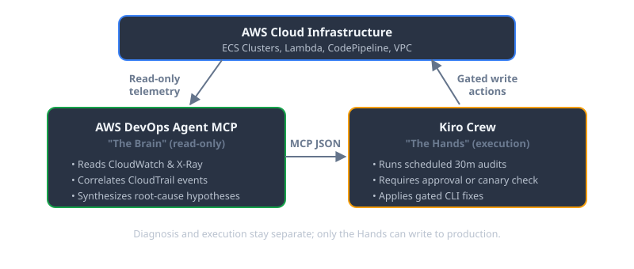

## Why Silent ECS Crash Loops Bypass PagerDuty

The most expensive outages in cloud infrastructure rarely trigger high-severity PagerDuty alerts. They are silent failures:

- An Amazon ECS service fails internal health checks every 4 minutes, restarts, and stays in a permanent flapping loop without tripping the 5% error rate alarm.
- An AWS CodePipeline deploy stage stalls indefinitely due to an IAM role assumption mismatch that emits no SNS notification.
- A Lambda function times out on 2% of requests because an upstream third-party webhook increased p99 latency by 400ms.

Human engineers discover these bugs only when a customer complains or when the AWS bill doubles. Traditional monitoring is purely reactive—it checks thresholds you knew to set up in advance.

## The Brain-and-Hands Pattern: Read-Only Diagnosis vs Controlled Execution

Giving an LLM unconstrained write permissions to your AWS production account is an invitation to disaster. The reliable architecture separates reasoning from execution.



*Figure 2: The Brain reads telemetry and proposes fixes; only the Hands can apply a gated write action to production.*

```
┌────────────────────────────────────────────────────────┐
│                   AWS Cloud Infrastructure             │
│        (ECS Clusters, Lambda, CodePipeline, VPC)        │
└──────────────┬───────────────────────────▲─────────────┘
               │ Read-Only Telemetry       │ Gated Write Actions
               ▼                           │
┌──────────────────────────────┐  MCP JSON ┌──────────────────────────────┐
│     AWS DevOps Agent MCP     │─────────▶│          Kiro Crew            │
│         ("The Brain")        │          │         ("The Hands")         │
│  - Reads CloudWatch & X-Ray  │          │  - Runs Scheduled 30m Audits  │
│  - Synthesizes Root Cause    │          │  - Applies Gated CLI Fixes    │
└──────────────────────────────┘          └──────────────────────────────┘
```

### 1. The Brain: AWS DevOps Agent MCP (Read-Only)
AWS DevOps Agent operates strictly in read-only mode via MCP across 34 diagnostic tools. It correlates CloudWatch log groups, AWS X-Ray traces, and CloudTrail event history to synthesize root-cause hypotheses and generate step-by-step mitigation plans.

### 2. The Hands: Kiro Crew (Execution Engine)
Kiro Crew acts as the local orchestration worker. It runs scheduled audits, invokes MCP diagnostic tools, inspects proposed remediation plans, and requires approval or runs automated canary verifications before executing CLI fixes.

## Step-by-Step Implementation: Configuring MCP and Autonomous Audits

### Step 1: Register the AWS DevOps Agent MCP Server
Add the MCP server to your local agent configuration with read-only AWS credentials:

```json
{
  "mcpServers": {
    "aws-devops": {
      "command": "uvx",
      "args": ["aws-devops-agent-mcp"],
      "env": {
        "AWS_REGION": "us-east-1",
        "AWS_PROFILE": "devops-agent-readonly"
      }
    }
  }
}
```

### Step 2: Configure Scheduled 30-Minute Audits (Cron)
Set up Kiro Crew to proactively inspect infrastructure health on a 30-minute interval:

```python
# crew_schedule.py
from kiro_crew import Crew, Task, Agent

# Define the diagnostic agent with read-only MCP access
devops_investigator = Agent(
    name="DevOps SRE Lead",
    role="Proactive Infrastructure Auditor",
    tools=["aws-devops-agent-mcp"],
    goal="Identify silent container crash loops, pipeline bottlenecks, and unhandled Lambda timeouts."
)

audit_task = Task(
    description="Query AWS DevOps Agent for service anomalies across all us-east-1 ECS clusters.",
    expected_output="Structured JSON diagnosis containing root cause, affected resources, and exact CLI remediation.",
    agent=devops_investigator
)

crew = Crew(agents=[devops_investigator], tasks=[audit_task])
crew.run_cron(schedule="*/30 * * * *")
```

### Step 3: Enforce Automated Verification and Safe Rollbacks
When an anomaly is detected—such as a task definition pointing to a deprecated environment variable—the agent generates and executes the specific fix:

```bash
# Generated and validated mitigation command
aws ecs update-service \
  --cluster production-cluster \
  --service payment-api \
  --task-definition payment-api:42 \
  --force-new-deployment
```

The agent then monitors task stabilization over the next 5 minutes to verify the crash loop has cleared.

## Comparison: Cloud Incident Response Approaches

| Dimension | CloudWatch + PagerDuty | Conversational Chatbot (ChatGPT UI) | Autonomous Agent (Kiro Crew + MCP) |
| :--- | :--- | :--- | :--- |
| **Detection Mode** | Reactive to static thresholds | Manual human prompt | Proactive 30-minute automated scans |
| **Telemetry Access** | Static dashboards | Manual log copy-pasting | Live, bidirectional MCP query access |
| **Mean Time to Resolution** | 1–3 Hours | 30–60 Minutes | **5–7 Minutes** |
| **Silent Failure Discovery**| None (Misses un-alarmed bugs) | None | Full coverage across all services |
| **Execution Safety** | Manual CLI execution | Manual copy-paste | Sandboxed with human approval gates |

## Security Guardrails: Keeping DevOps Agents Safe

- **Never Give the LLM Full IAM Admin:** The reasoning agent should only have read permissions (`CloudWatchReadOnlyAccess`, `AWSXRayReadOnlyAccess`).
- **Human-in-the-Loop for Destructive Ops:** Any action that alters security groups, modifies database schemas, or drops instances must pause for human Slack confirmation.
- **Scope Regional API Limits:** Querying CloudWatch across all global regions simultaneously triggers AWS API rate limits. Scope audit loops to active production regions.

## Frequently Asked Questions

### What is the Model Context Protocol (MCP) in DevOps?
The Model Context Protocol (MCP) is an open standard that allows AI agents to securely connect to external tools, databases, and cloud APIs like AWS CloudWatch and ECS.

### How does an AI agent detect silent failures without alarms?
The agent runs scheduled programmatic audits against cloud service APIs, comparing desired service states (e.g., target task counts) against live health check metrics.

### Is it safe to allow an AI agent to fix AWS infrastructure?
Yes, when using a decoupled architecture where the diagnostic agent is read-only and write actions are gated by strict IAM roles, verification tests, or human approvals.

### How does this setup reduce Mean Time to Resolution (MTTR)?
By autonomously correlating CloudWatch logs, X-Ray traces, and deployment histories within seconds, eliminating manual triage delays during on-call incidents.

### What AWS services can be monitored via AWS DevOps Agent MCP?
AWS DevOps Agent MCP supports Amazon ECS, AWS Lambda, Amazon EKS, AWS CodePipeline, AWS CodeBuild, Amazon RDS, CloudWatch, and AWS X-Ray.

## Conclusion & Key Takeaways

Combining Kiro Crew with AWS DevOps Agent MCP shifts cloud operations from reactive firefighting to continuous automated reliability audits. By enforcing read-only diagnostic boundaries and controlled remediation workflows, teams eliminate silent failure loops and reduce MTTR from hours to minutes.
