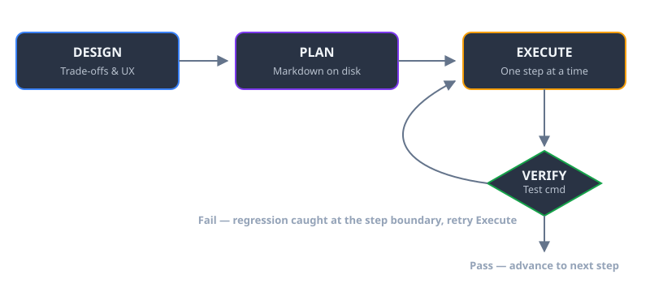

## What Claude Code Actually Is (And What It Isn't)

Claude Code is an agentic, terminal-native AI coding assistant that runs directly in your local repository to inspect files, execute shell commands, edit code across files, and create git commits.

Most discussions about AI coding oscillate between breathless hype and dismissal from people who only tried autocomplete plugins. Claude Code is neither autocomplete nor a chat box where you copy-paste snippets back and forth. It has full shell access, reads your whole repository, runs test suites, inspects compiler errors, and writes multi-file diffs directly to disk.

## Why Terminal Agents Beat Autocomplete for Multi-File Refactors

Editor autocomplete excels at writing the next 5 lines of a function you already understand. It fails completely when a task spans multiple files, requires running a build command, or involves diagnosing why a test suite failed after a dependency bump.

```
┌────────────────────────────────────────────────────────┐
│                   Developer Terminal                   │
│  ┌──────────────────────────────────────────────────┐  │
│  │ Claude Code (Terminal REPL Agent)                │  │
│  └────────┬─────────────────────┬───────────────────┘  │
│           │ Tool Calls          │ Shell Commands       │
│           ▼                     ▼                      │
│  ┌─────────────────┐   ┌─────────────────────────────┐ │
│  │ Local Filesystem│   │ Test Runner / Build Tooling │ │
│  │ (Multi-file edit│   │ (pytest, vitest, tsc, cargo)│ │
│  └─────────────────┘   └─────────────────────────────┘ │
└────────────────────────────────────────────────────────┘
```

The difference comes down to three operational capabilities:

- **Repository-Wide Context:** It inspects package manifests, config files, and internal utilities rather than guessing from open editor tabs.
- **Closed Execution Loops:** It runs tests, sees the exact stack trace, adjusts its implementation, and reruns the suite until it passes.
- **Git Native Operation:** Every edit produces standard git diffs you can review with `git diff` before committing.

## The Design-Plan-Execute Loop: Keeping Agents on Rails

Giving an agent free rein on a blank prompt produces sprawling, over-engineered messes. The fix is strictly separating work into three distinct phases.



*Figure 2: A failed verification loops back to Execute immediately, instead of letting regressions accumulate across steps.*

```
┌─────────────────┐       ┌─────────────────┐       ┌─────────────────┐
│     DESIGN      │ ────▶ │      PLAN       │ ────▶ │     EXECUTE     │
│ Trade-offs & UX │       │ Markdown on Disk│       │ Code & Verify   │
└─────────────────┘       └─────────────────┘       └─────────────────┘
```

### 1. The Design Phase: Argue Before You Code
Before touching a single file, talk through the architectural trade-offs. Push back on the agent's first suggestion. Ask: "What are three alternative ways to structure this, and what breaks in each?" Write down the chosen approach in a markdown file in your repo (e.g., `docs/plans/`).

### 2. The Planning Phase: Persistent Memory on Disk
Break the design into atomic steps with explicit acceptance criteria. An in-memory prompt loses context over long sessions; a markdown file on disk does not. Every step must state:
- Exact files to create or modify
- The verification command (e.g., `npm test -- api/auth.test.ts`)
- The expected outcome

### 3. The Execution Phase: Step-by-Step Verification
Let the agent execute one task at a time. Because each step has a concrete test command, regressions are caught immediately at step boundaries rather than after 500 lines of un-reviewed code have piled up.

## Setting Up Your Repository for Claude Code

Here is the setup that keeps agent work organized and safe:

### Step 1: Configure Project Directories
Create dedicated directories for task plans and configuration:

```bash
mkdir -p .claude docs/plans
```

### Step 2: Write an Atomic Task Plan
Create a timestamped markdown file before starting non-trivial features:

```markdown
<!-- docs/plans/2026-04-28-vercel-migration.md -->
# Task: Migrate Express Analytics Proxy to Vercel Functions

1. Extract shared authentication helpers to `api/_utils/auth.ts`.
2. Implement serverless handler in `api/analytics.ts`.
3. Port environment variable bindings from existing Railway config.
4. Run integration suite: `npm test -- api/analytics.test.ts`.
5. Verify response payload matches existing API contract.
```

### Step 3: Run in Isolated Git Worktrees
For major refactors or risky migrations, isolate the agent in a git worktree so your active working tree remains untouched:

```bash
git worktree add ../migration-branch -b feat/migration
cd ../migration-branch
claude
```

### Step 4: Review Every Diff Manually
Never let an agent push directly. Run `git diff` and review every changed hunk. You own the code in production, not the model.

## Four Real Tasks I Regularly Offload to Claude Code

1. **Express to Serverless Migrations:** Splitting monolithic route handlers into isolated serverless functions, extracting utility files, and updating routing tables.
2. **Static Prebuild Scripts:** Generating custom Groq/GraphQL extraction scripts that pull data from a headless CMS and format dynamic XML sitemaps.
3. **Test Suite Expansion:** Taking an existing module and generating targeted unit tests for unhandled error branches and boundary conditions.
4. **Dependency Upgrades:** Bumping major versions of libraries, running the test suite, and fixing deprecated API call sites until all tests pass green.

## Comparison: AI Coding Paradigms

| Dimension | Editor Autocomplete (Copilot) | Chat Windows (ChatGPT Web) | Terminal Agent (Claude Code) |
| :--- | :--- | :--- | :--- |
| **Context Scope** | Current file & open tabs | Copy-pasted snippets | Entire local repository |
| **Command Execution**| None | None | Full shell access (tests, git, build)|
| **Multi-File Edits** | Single-line suggestions | Manual copy-pasting | Autonomous across whole tree |
| **Memory Persistence**| None | Session-based | Markdown plans saved in repo |
| **Best Used For** | Fast boilerplate typing | Brainstorming concepts | Multi-step refactors & workflows |

## Failure Modes: Where Claude Code Breaks Down

- **Premise Acceptance:** If you say "I think our Redis cache is corrupt," the agent will often spend 20 minutes proving your incorrect theory right. Always provide raw error logs instead of your diagnosis.
- **Context Degradation in Long Sessions:** After 30+ turns, the agent forgets early decisions. Keep task plans in markdown on disk to ground the session.
- **Aesthetic Decisions:** Terminal agents write clean TypeScript and passing tests, but their CSS aesthetics are mediocre. Handle visual layout and spacing yourself.

## Frequently Asked Questions

### How does Claude Code differ from GitHub Copilot?
Copilot provides real-time line completions inside your editor. Claude Code runs in your terminal, executes commands, runs test suites, and edits multiple files across your entire codebase autonomously.

### Why should I write plans in markdown before writing code?
Markdown plans serve as persistent memory on disk. They prevent context loss during long sessions and force you to validate architecture before generating code.

### Is it safe to give Claude Code terminal command access?
Yes, when paired with permission controls and executed in separate Git branches or worktrees where diffs can be inspected before merging.

### What tasks are best suited for Claude Code?
Claude Code excels at multi-file refactors, test suite generation, serverless migrations, dependency updates, and repetitive boilerplate scripts.

### Does Claude Code eliminate the need for code review?
No. Developers remain 100% accountable for code correctness, security boundaries, and performance. Every generated diff must be reviewed with `git diff`.

## Conclusion & Key Takeaways

Claude Code turns development from manual typing into structured delegation. Use a Design-Plan-Execute workflow, write task plans to disk, run tests continuously, and review every diff before committing.
