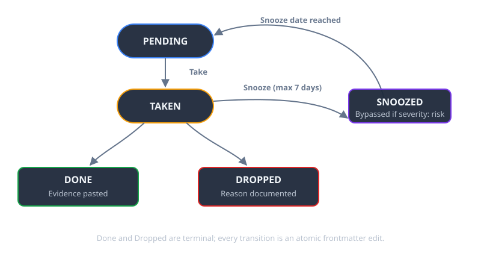

## Why Redis and Linear Are Overkill for Local CLI Agents

When running autonomous coding agents across multiple local repositories, cross-project dependencies happen constantly: a frontend agent discovers an unhandled 404 in the backend API, or a build script needs a new export from a shared utility package.

The common reflex is to reach for distributed infrastructure: spinning up Redis queues, setting up RabbitMQ, or hooking into Linear/Jira APIs.

This introduces immediate friction:
- API rate limits and webhook failures.
- Auth token rotation across agent environments.
- Invisible state trapped inside external SaaS platforms.
- Race conditions when two agents attempt simultaneous cross-repo edits.

A filesystem directory of markdown files eliminates all four problems.

```
handovers/
├── board.md                  # Auto-generated one-page status board
├── site/
│   ├── 004-syndication.md    # status: done
│   └── 007-display-shapes.md # status: pending
└── tooling/
    └── 012-retry-helper.md   # status: taken
```

## The 4-State Machine: Atomic Handovers Without Lock Contention

To coordinate multiple agents safely, task files follow a strict state machine with explicit ownership.



*Figure 2: Every transition is an atomic edit to the task file's frontmatter, so two agents can never claim the same task.*

```
              ┌─────────┐
              │ PENDING │ ◀─────── (Snooze Date Reached)
              └────┬────┘
                   │
         [Take]    │           [Snooze / Max 7 Days]
                   ▼             │
              ┌─────────┐        ▼
              │  TAKEN  │   ┌─────────┐
              └────┬────┘   │ SNOOZED │ (Bypassed if severity: risk)
                   │        └─────────┘
      ┌────────────┴────────────┐
      ▼                         ▼
┌───────────┐             ┌───────────┐
│   DONE    │             │  DROPPED  │
│ (Evidence │             │  (Reason  │
│  Pasted)  │             │ Document) │
└───────────┘             └───────────┘
```

1. **`pending`:** Unassigned task waiting in a target project directory.
2. **`taken`:** Claimed by an agent upon session start. The agent immediately edits frontmatter before starting work.
3. **`snoozed`:** Blocked waiting on upstream dependencies. Snoozing is capped at 7 days to prevent stagnant backlogs.
4. **`done` / `dropped`:** Terminal states. `done` requires pasted terminal output; `dropped` requires a documented technical justification.

## The Task Schema: Clear Asks and Mandatory Evidence

Agents fail when given ambiguous prompts. Every task file must fit on a single screen and adhere to this structure:

```markdown
---
status: pending
severity: normal
created: 2026-08-09
target_repo: tooling
---
# Align Retry Helper with New Timeout API

## The Ask
The retry utility in `src/utils/retry.ts` passes deprecated options dropped in upstream v3. Update call sites and run the test suite.

## Context Links
- CI failure run: logs/ci-run-4819.log
- Upstream changelog: https://github.com/org/pkg/releases/v3.0.0

## Acceptance Test
Command: `npm test -- test/retry.test.ts`
Criterion: Process exits with code 0 and all 12 retry assertions pass.

## Evidence
<!-- The agent must paste terminal test output here before marking done -->
```

## Three Rules That Prevent Agent Hallucinations

1. **Mandatory Evidence Pasting:** An agent cannot set `status: done` without pasting the exact terminal stdout/stderr proving the test command exited with code 0.
2. **Strict Single-Repo Write Boundaries:** An agent working in Repo A is prohibited from modifying files in Repo B directly. Its only valid action is writing a task file to `handovers/repo-b/`.
3. **Verified Absence Claims:** Agents cannot declare "no documentation exists" without listing the exact file paths and directories searched.

## Comparison: Multi-Agent Task Orchestration

| Dimension | Shared Markdown Directory | Redis / Celery Task Queue | SaaS Trackers (Linear / Jira) |
| :--- | :--- | :--- | :--- |
| **Infrastructure** | Plain Text on Filesystem | Local Redis Daemon | External Cloud SaaS |
| **Audit Trail** | Git Commit Log | Requires Logging Database | SaaS Event Logs |
| **Offline Operation** | **100% Offline** | Local Only | None (Requires Internet) |
| **Human Readability** | Native Markdown | Requires Custom Dashboard | Web UI |
| **Setup Overhead** | `mkdir handovers` | Server Config & Drivers | API Keys & Webhook Hooks |

## Common Failure Modes

- **Unbounded Snoozing:** Allowing tasks to be snoozed indefinitely creates backlogs of forgotten technical debt. Hard-cap snoozes at 7 days.
- **Vague Prompts:** Tasks like "refactor auth module" get dropped or mangled. Always include the specific test command and file paths.
- **Silent Dropping:** Forbid agents from deleting task files. If a task is abandoned, it must transition to `dropped` with an explanation.

## Frequently Asked Questions

### Why not use Redis or RabbitMQ for agent task queues?
Markdown files eliminate external server dependencies, integrate directly into Git version control, and allow humans and AI agents to read and modify tasks using standard text editors.

### How do agents prevent race conditions on shared task files?
Agents read the directory upon session startup, check for unassigned `pending` tasks, and immediately commit a status change to `taken` before executing the work.

### What happens if an agent fails a task midway?
If an agent cannot fulfill the acceptance test, it reverts the status to `pending` with an explanatory note or marks it `dropped` with diagnostic logs attached.

### Can background cron jobs use this markdown task queue?
Yes. Scheduled nightly automation scripts can parse pending markdown files, execute routine refactoring or dependency updates, and record output evidence autonomously.

### How are task boards generated from individual markdown files?
A simple pre-commit script or lightweight Python CLI scans all markdown frontmatter across project subdirectories and compiles a unified `board.md` overview table.

## Conclusion & Key Takeaways

File-based task queues provide a zero-infrastructure mechanism for managing autonomous agent handovers across repositories. By enforcing strict state transitions and requiring terminal evidence before completion, you eliminate race conditions and keep multi-agent workflows transparent and reliable.
