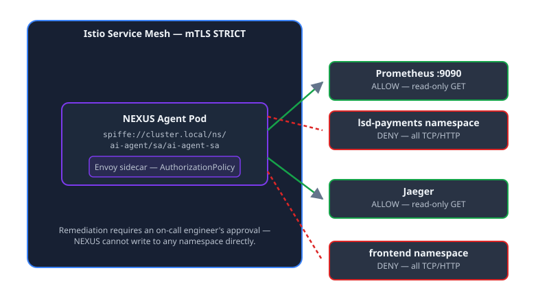

## Why Granting kubectl Permissions to LLMs Is a Critical Threat

Giving an LLM-powered operations agent `cluster-admin` RBAC or `kubectl exec` access is an architectural failure. 

In production Kubernetes clusters, unconstrained AI agents introduce three unacceptable risks:
1. **Prompt Injection via Telemetry:** A malicious payload embedded in an HTTP header or log line can hijack the agent's reasoning loop and trick it into running destructive commands.
2. **Cascading Failure Loops:** An agent observing high memory usage might start deleting pods during a database failover, turning a temporary slow-down into a full outage.
3. **Audit Impossibility:** If an LLM runs raw shell commands directly against cluster APIs, reconstructing the incident timeline during a post-mortem becomes impossible.

The solution is zero trust: treating the AI agent pod as an untrusted workload with zero network reach into application pods.

```
┌────────────────────────────────────────────────────────────────────────┐
│                   Kubernetes Cluster (Amazon EKS)                      │
│                                                                        │
│  ┌─────────────────────────┐              ┌─────────────────────────┐  │
│  │   ai-agent Namespace    │              │  lsd-payments Namespace │  │
│  │  ┌───────────────────┐  │              │  ┌───────────────────┐  │  │
│  │  │ NEXUS AIOps Pod   │  │   STRICT     │  │ Application Pods  │  │  │
│  │  │ (Claude Sonnet)   │  │    mTLS      │  │ (Payments Backend)│  │  │
│  │  └─────────┬─────────┘  │              │  └─────────▲─────────┘  │  │
│  │            ▼            │              │            │            │  │
│  │  ┌───────────────────┐  │              │  ┌─────────┴─────────┐  │  │
│  │  │   Envoy Sidecar   │──┼──────────────┼──│   Envoy Sidecar   │  │  │
│  │  └─────────┬─────────┘  │  DENY Policy │  └───────────────────┘  │  │
│  └────────────┼────────────┘              └─────────────────────────┘  │
│               │                                                        │
│       ALLOW   │ Telemetry Read Only                                    │
│               ▼                                                        │
│  ┌──────────────────────────────────────────────────────────────────┐  │
│  │                     istio-system Namespace                       │  │
│  │           Prometheus  •  Jaeger Traces  •  Kiali Topology        │  │
│  └──────────────────────────────────────────────────────────────────┘  │
└────────────────────────────────────────────────────────────────────────┘
```

## The Istio + SPIFFE Blast Radius Quarantine

To isolate NEXUS while allowing it to diagnose issues, the architecture enforces three strict boundaries:



*Figure 2: The sidecar's AuthorizationPolicy allows read-only telemetry queries and denies everything else, including the payments and frontend namespaces.*

### 1. Cryptographic SPIFFE Identity
NEXUS runs with an identity minted by Istio (`spiffe://cluster.local/ns/ai-agent/sa/ai-agent-sa`). All communication inside the mesh requires mutual TLS (`mode: STRICT`).

### 2. Sidecar Layer-7 AuthorizationPolicies
Istio Envoy sidecars enforce network boundaries:
- **`ALLOW`:** Read-only `GET` queries to Prometheus (`http://prometheus.istio-system:9090`) and Jaeger.
- **`DENY`:** All TCP/HTTP connections to application namespaces (`lsd-payments`, `frontend`).

### 3. Decoupled Click-to-Approve Remediation
NEXUS outputs structured JSON diagnostic reports containing the root cause and proposed fix. It cannot apply changes directly; execution requires an on-call engineer's approval in Grafana Cloud IRM or Discord.

## Step-by-Step Configuration: Istio Security Policies

### Step 1: Isolate the Agent Namespace
Create the namespace with automatic Istio sidecar injection:

```yaml
apiVersion: v1
kind: Namespace
metadata:
  name: ai-agent
  labels:
    istio-injection: enabled
---
apiVersion: v1
kind: ServiceAccount
metadata:
  name: ai-agent-sa
  namespace: ai-agent
```

### Step 2: Apply Layer-7 AuthorizationPolicies
Allow Prometheus telemetry reads while dropping all outbound traffic to payment services:

```yaml
# Allow Read-Only Access to Prometheus in istio-system
apiVersion: security.istio.io/v1beta1
kind: AuthorizationPolicy
metadata:
  name: allow-telemetry-read
  namespace: istio-system
spec:
  selector:
    matchLabels:
      app: prometheus
  action: ALLOW
  rules:
  - from:
    - source:
        principals: ["cluster.local/ns/ai-agent/sa/ai-agent-sa"]
    to:
    - operation:
        methods: ["GET"]
---
# Deny Direct Communication to Application Pods
apiVersion: security.istio.io/v1beta1
kind: AuthorizationPolicy
metadata:
  name: deny-app-workloads
  namespace: lsd-payments
spec:
  action: DENY
  rules:
  - from:
    - source:
        principals: ["cluster.local/ns/ai-agent/sa/ai-agent-sa"]
```

### Step 3: Implement the Telemetry Polling Loop
NEXUS continuously monitors Prometheus error rate metrics:

```python
import requests
import json
from typing import Dict, Any

def evaluate_mesh_telemetry() -> None:
    """
    Polls Prometheus for HTTP 5xx error rate anomalies across the service mesh.
    """
    prom_query = 'sum(rate(istio_requests_total{response_code=~"5.*"}[1m])) / sum(rate(istio_requests_total[1m]))'
    res = requests.get(
        "http://prometheus.istio-system:9090/api/v1/query", 
        params={"query": prom_query},
        timeout=5.0
    )
    data = res.json()
    error_rate = float(data["data"]["result"][0]["value"][1])
    
    if error_rate > 0.05:
        trigger_ai_diagnosis(error_rate)

def trigger_ai_diagnosis(error_rate: float) -> None:
    print(f"Mesh error rate threshold breached: {error_rate * 100:.2f}%. Triggering Claude Sonnet diagnosis.")
```

## Validating Resilience with Chaos Mesh (56.5% Error Rate Test)

To test the isolation and diagnostic capability, we injected a `NetworkChaos` packet delay into the payment service:

1. **Detection (0:30):** NEXUS caught a 56.5% error spike within a single 30-second polling cycle.
2. **Diagnosis (1:15):** Claude Sonnet isolated the fault to `lsd-backend`, ruled out DNS failures, and flagged a telemetry `NaN` artifact.
3. **Gated Remediation (2:00):** NEXUS published a 6-step mitigation plan to Grafana IRM. An engineer clicked "Approve", triggering a worker to clear the Chaos Mesh experiment.
4. **Recovery (3:45):** Synthetic probes verified 100% traffic recovery. At no point did the AI pod have direct access to payment workloads.

## Comparison: AI Operations Security Models

| Security Dimension | Unconstrained Root Agent | Kubernetes RBAC Only | Zero Trust Istio Mesh (NEXUS) |
| :--- | :--- | :--- | :--- |
| **Identity Mechanism** | Static API Key | ServiceAccount Token | SPIFFE Cryptographic Certificate |
| **Network Boundary** | Unrestricted Flat Mesh | Layer 3/4 NetworkPolicy | Layer 7 Envoy Sidecar AuthPolicy |
| **App Pod Access** | Full Read/Write | Namespace Scoped | **Cryptographically Blocked (DENY)** |
| **Remediation Model** | Direct autonomous `kubectl` | Webhook Trigger | **Human Click-to-Approve Gate** |
| **Compromise Risk** | Full Cluster Takeover | Namespace Compromise | **Zero (Agent Isolated in Sandbox)** |

## Common Security Mistakes with AI SRE Tools

- **Granting Direct Cluster RBAC to Agents:** Giving an LLM `kubectl` write permissions turns any prompt injection into a cluster compromise.
- **Relying Exclusively on L3/L4 NetworkPolicies:** IP-based firewalls cannot enforce SPIFFE cryptographic identity or HTTP GET/POST method boundaries.
- **Automating Unverified Destructive Fixes:** Pod terminations and DB failovers must require human confirmation.

## Frequently Asked Questions

### How does Istio prevent an AI agent from attacking application pods?
Istio sidecar proxies enforce layer-7 `AuthorizationPolicy` rules that drop all network connections originating from the agent's SPIFFE principal toward application namespaces.

### What is the role of SPIFFE in AI agent security?
SPIFFE provides an immutable, cryptographically verifiable identity embedded in mutual TLS certificates, ensuring the service mesh accurately recognizes the agent on every network hop.

### Can NEXUS automatically fix production outages?
NEXUS generates structured remediation plans, but actual execution requires human confirmation via Grafana Cloud IRM or webhook approval gates.

### How does NEXUS ingest cluster metrics safely?
NEXUS communicates with Prometheus and Jaeger via read-only HTTP GET endpoints permitted under specific Istio sidecar authorization rules.

### What happens if the AI agent's LLM hallucinates a remediation command?
Because the agent lacks Kubernetes API write permissions, hallucinated commands cannot execute directly against production infrastructure.

## Conclusion & Key Takeaways

AI agents bring speed to root-cause diagnosis, but production reliability requires architectural isolation. By combining Amazon EKS, Istio service mesh, SPIFFE identity, and human approval gates, platform teams get fast incident analysis without handing cluster keys to an LLM.
